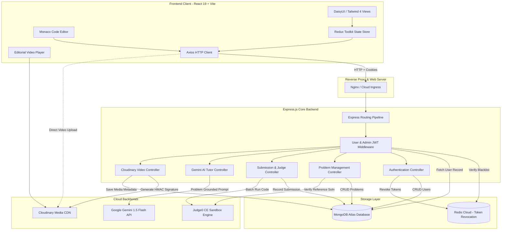
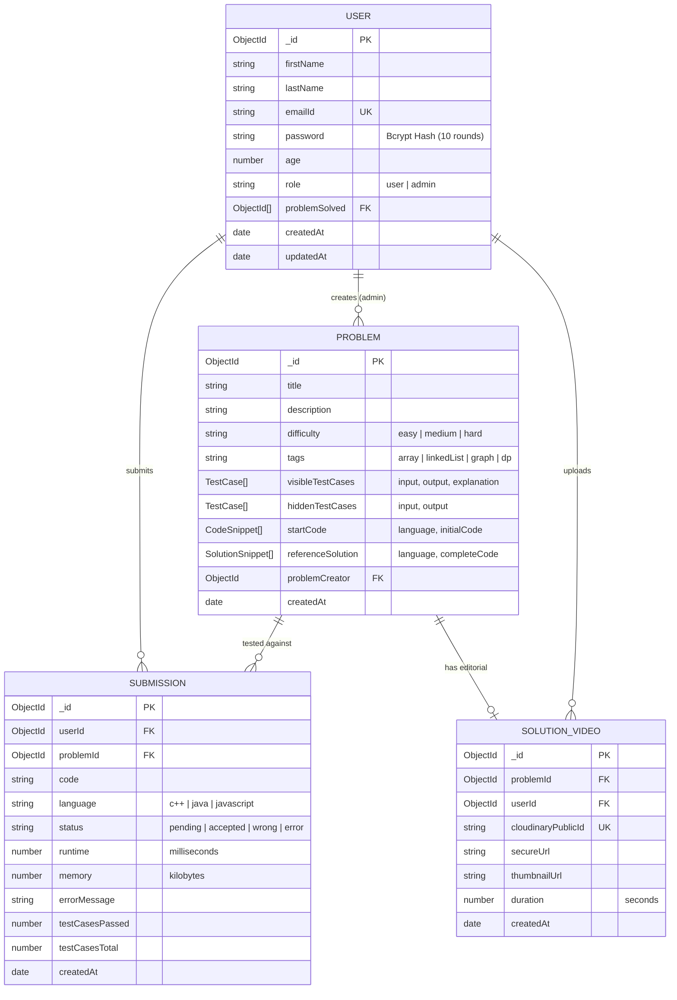
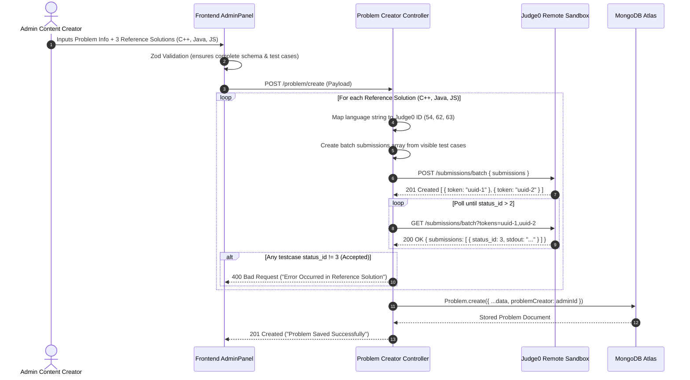
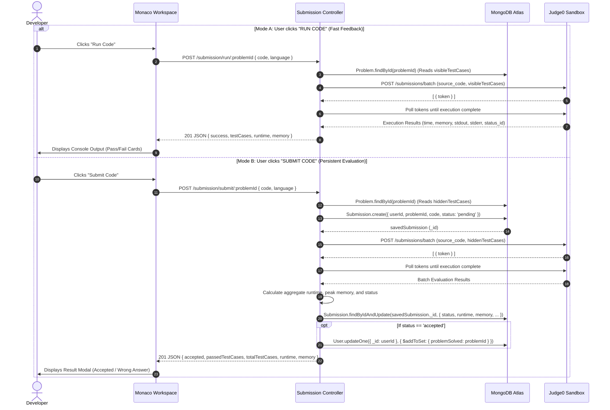
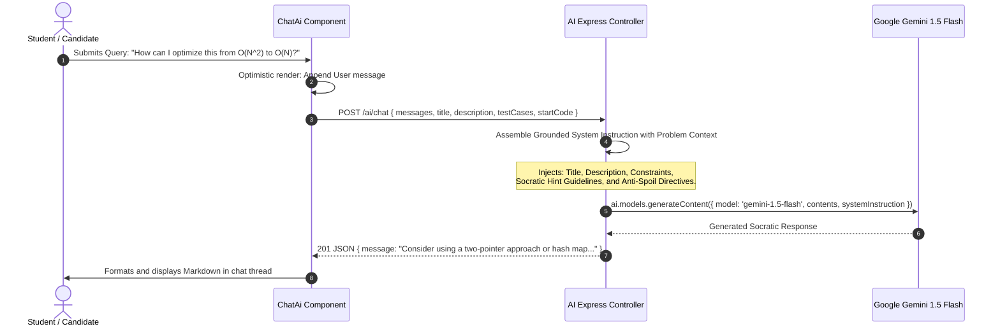
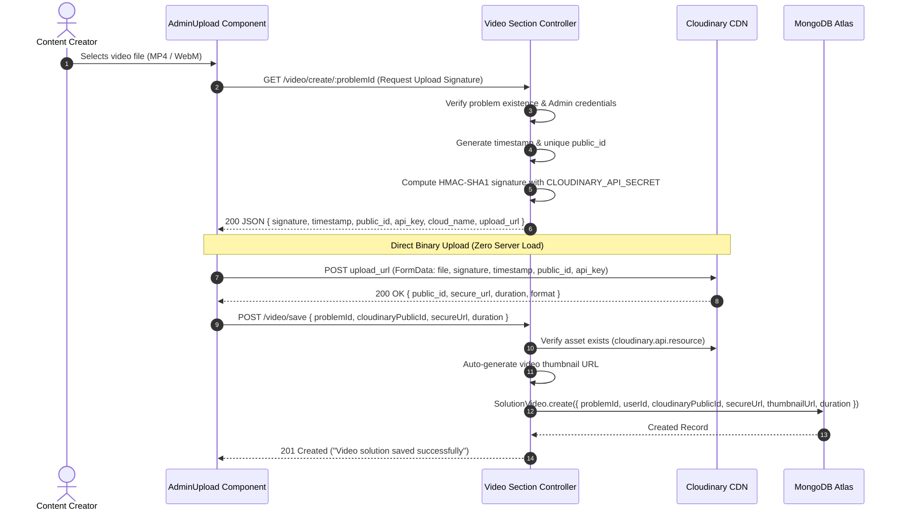
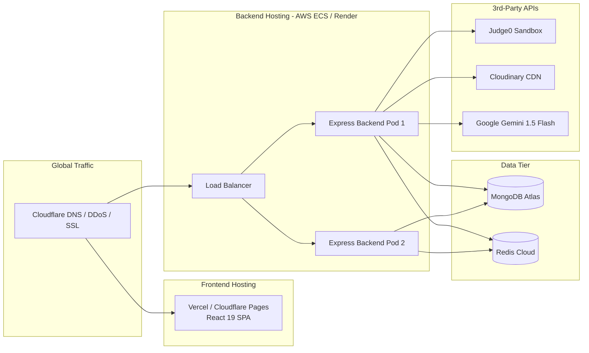
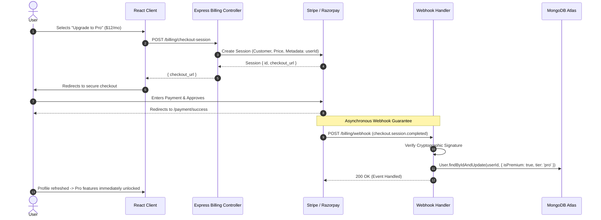

# System Architecture & Technical Workflow Documentation

**Project Name:** CodeEzz (LeetCode-Style Platform with Gemini AI & Cloudinary Video Solutions)  
**Document Classification:** Technical Architecture & System Workflow Specification  
**Version:** 1.0.0-PROD  
**Target Environment:** Production Full-Stack Distributed Deployment  

---

## 1. High-Level Architecture Overview

CodeEzz is architected as an asynchronous, distributed full-stack application. It delegates resource-intensive and specialized tasks (untrusted code execution, generative AI inference, high-bandwidth media transcoding) to external managed services while preserving a lightweight, secure orchestration layer.



---

## 2. Data Models & Entity Relationship Specification

### 2.1 Entity Relationship Diagram



### 2.2 Redis In-Memory Key Schema
- **Key Format:** `token:<raw_jwt_string>`
- **Value:** `"Blocked"`
- **TTL Strategy:** Synchronized to the JWT `exp` timestamp via `redisClient.expireAt(key, payload.exp)`.
- **Space Efficiency:** Keys automatically expire from memory once the token naturally expires, preventing memory leaks in Redis.

---

## 3. Module-by-Module Technical Deep Dive

### 3.1 Identity, Session & RBAC Module
- **Password Hashing:** `bcrypt` with 10 salt rounds.
- **Session Delivery:** HTTP-only cookie (`token`) containing a signed JSON Web Token (`JWT_KEY`) with a 1-hour expiration.
- **Middleware Guards:**
  - `userMiddleware`: Decodes token, validates user existence in MongoDB, checks against Redis blocklist.
  - `adminMiddleware`: Extends `userMiddleware` by verifying `payload.role === 'admin'`.
- **Logout & Invalidation:** Token payload `exp` is read and saved to Redis. Subsequent requests with the same cookie are blocked with HTTP 401.

### 3.2 Problem Catalog & Creator Module
- **Automated Validation Gate:** On problem creation (`POST /problem/create`) and update (`PUT /problem/update/:id`), the backend submits all reference solutions (C++, Java, JavaScript) to Judge0 batch endpoints against the visible test cases. If any test case yields `status_id !== 3`, the request is rejected with HTTP 400.
- **Query Optimizations:** Catalog retrieval (`GET /problem/getAllProblem`) uses selective projections (`.select('_id title difficulty tags')`) to keep payloads light.
- **User Solved Association:** Solved status is populated via `user.problemSolved` array reference lookups.

### 3.3 Sandboxed Code Execution Pipeline
- **Engine:** RapidAPI Judge0 Community Edition (CE).
- **Supported Languages & IDs:**
  - C++ (GCC 9.2.0) $\rightarrow$ Language ID: `54`
  - Java (OpenJDK 13.0.1) $\rightarrow$ Language ID: `62`
  - JavaScript (Node.js 12.14.0) $\rightarrow$ Language ID: `63`
- **Execution Modes:**
  1. **Run Code:** Evaluates user code against `visibleTestCases`. No persistent database write. Returns execution breakdown per sample case.
  2. **Submit Code:** Creates a persistent `Submission` record with status `pending`. Dispatches batch payload to Judge0 against `hiddenTestCases`. Polls execution tokens until completion (`status_id > 2`). Aggregates total execution time and peak memory. If all test cases pass, updates `user.problemSolved`.

### 3.4 AI Doubt Solver Engine (Google Gemini)
- **Model:** `gemini-1.5-flash` via `@google/genai` SDK.
- **Grounded Prompt Construction:** Injects the active problem's title, description, visible test cases, and starter code into system instructions.
- **Pedagogical Guardrails:**
  - Enforces Socratic dialogue (asks guiding questions instead of giving answers).
  - Strictly rejects non-DSA questions (web development, sysadmin, general knowledge).
  - Reviews student code submissions for logic errors and explains Big-O complexities.

### 3.5 Cloud Video Editorial Pipeline (Cloudinary)
- **Zero-Server-Load Pattern:**
  1. Admin frontend requests signed upload credentials from Express (`GET /video/create/:problemId`).
  2. Express signs timestamp, public ID, and API key using `CLOUDINARY_API_SECRET` (HMAC-SHA1).
  3. Frontend uploads binary directly to Cloudinary's REST API with live upload progress tracking.
  4. Frontend informs Express of successful upload (`POST /video/save`).
  5. Express verifies the resource on Cloudinary, auto-generates video thumbnail URLs, and stores metadata in MongoDB.

### 3.6 Frontend Architecture & State Management
- **Framework:** React 19 + Vite.
- **Styling & Components:** Tailwind CSS 4 + DaisyUI 5.
- **Editor:** `@monaco-editor/react` (VS Code core) configured for dynamic language switching, dark theme (`vs-dark`), syntax highlighting, and auto-formatting.
- **State Store (Redux Toolkit):** `authSlice` manages global user authentication, session bootstrap (`checkAuth`), and login/logout state.
- **Form Handling:** `react-hook-form` paired with `@hookform/resolvers/zod` for type-safe client-side validation.

---

## 4. End-to-End Real-World System Workflows

### 4.1 Authentication & Token Revocation Workflow

```mermaid
sequenceDiagram
    autonumber
    actor Client as User / Browser
    participant API as Express Auth Router
    participant DB as MongoDB Atlas
    participant Cache as Redis Cloud

    Note over Client,Cache: 1. Registration / Login Flow
    Client->>API: POST /user/login { emailId, password }
    API->>DB: User.findOne({ emailId })
    DB-->>API: User Document (Bcrypt Hash)
    API->>API: bcrypt.compare(password, user.password)
    API->>API: jwt.sign({ _id, emailId, role }, JWT_KEY, expiresIn: 1h)
    API-->>Client: Set-Cookie: token=JWT; HttpOnly; MaxAge=3600
    
    Note over Client,Cache: 2. Authenticated Request
    Client->>API: GET /problem/getAllProblem (Cookie attached)
    API->>API: jwt.verify(token, JWT_KEY)
    API->>Cache: EXISTS token:{token}
    Cache-->>API: 0 (Token Valid)
    API->>DB: User.findById(_id)
    API-->>Client: 200 OK (Problem List)

    Note over Client,Cache: 3. Logout Flow (Immediate Token Revocation)
    Client->>API: POST /user/logout
    API->>API: jwt.decode(token) -> extracts exp
    API->>Cache: SET token:{token} 'Blocked'
    API->>Cache: EXPIREAT token:{token} exp
    API-->>Client: Clear-Cookie: token; 200 "Logged Out Successfully"
    
    Note over Client,Cache: 4. Rejected Re-use of Blocked Token
    Client->>API: GET /problem/getAllProblem (Using old token)
    API->>Cache: EXISTS token:{token}
    Cache-->>API: 1 (Blocked!)
    API-->>Client: 401 Unauthorized ("Invalid Token")
```

---

### 4.2 Problem Creation & Reference Solution Verification Gate



---

### 4.3 Code Execution Pipeline: "Run" vs "Submit"



---

### 4.4 AI Context-Aware Doubt Resolution Workflow



---

### 4.5 Cloudinary Direct Video Editorial Upload Pipeline



---

## 5. Architectural Findings & Code Audit

During our architectural inspection of `14Dev/backend` and `14Dev/frontend`, four technical findings were identified for immediate remediation during Phase 1 hardening:

### Finding 1: Broken Sleep Mechanism in Judge0 Poller (`problemUtility.js`) — [RESOLVED in Phase 1]
- **Location:** `backend/src/utils/problemUtility.js`
- **Resolution:** Replaced the non-blocking `setTimeout` with a standard Promise-based delay utility:
  ```javascript
  const delay = (ms) => new Promise((resolve) => setTimeout(resolve, ms));
  // In polling loop:
  await delay(1000);
  ```
- **Result:** Code execution requests now wait 1000ms between polls, eliminating CPU spinlocks and preventing 429 Too Many Requests errors.

### Finding 2: Direct Network Exposure of Complete Reference Solutions — [RESOLVED in Phase 1]
- **Location:** `backend/src/controllers/userProblem.js`
- **Resolution:** Stripped `referenceSolution` from the public `getProblemById` query projection:
  ```javascript
  const getProblem = await Problem.findById(id).select('_id title description difficulty tags visibleTestCases startCode');
  ```
- **Result:** Reference solutions are no longer visible via client-side network inspectors. Full solutions will be unlocked only after verification or via Pro subscription authorization.

### Finding 3: Unconditional Problem Solved Marker on Submissions — [RESOLVED in Phase 1]
- **Location:** `backend/src/controllers/userSubmission.js`
- **Resolution:** Added condition to only append `problemId` to `user.problemSolved` when `status === 'accepted'` and added detailed error status codes (TLE, Compilation Error, Runtime Error).

### Finding 4: Lack of Queueing for Code Submissions — [Scheduled for Phase 3]
- **Location:** `backend/src/controllers/userSubmission.js`
- **Architectural Risk:** Every submission directly spawns asynchronous batch calls to Judge0. Under concurrent traffic, this easily hits 429 Too Many Requests errors.
- **Remediation Specification:** Integrate BullMQ with Redis to buffer submissions during traffic spikes and process executions deterministically.

---

## 6. Cloud Production Deployment Architecture



### 6.1 Docker Containerization Strategy
- **Backend `Dockerfile`:** Multi-stage build based on `node:20-alpine`. Employs production node flags, runs under an unprivileged `node` user, and includes a native health check calling `/health`.
- **Frontend `Dockerfile` / Static Export:** Built with `npm run build` producing optimized Vite chunks, served via Nginx with HTTP/2 and Brotli compression.

---

## 7. Monetization Integration Architecture (Stripe / Razorpay)


